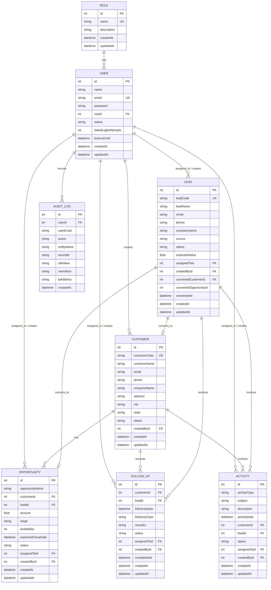

# AcxiomCRM Database Design & Architecture

This document details the relational database schema, tables, relationships, constraints, and entity-relationship models powering the AcxiomCRM platform using **PostgreSQL** and **Prisma ORM**.

---

## 1. Entity-Relationship Diagram (ERD)

---

## 2. Table Specifications

### 2.1 `Role` Table
Stores permissions and access tiers in the system.
* **`id`** (`Int`, Primary Key, Autoincrement)
* **`name`** (`VarChar`, Unique, Indexed): e.g. `ADMIN`, `MANAGER`, `SALES_EXECUTIVE`
* **`description`** (`Text`, Nullable): Human-readable definition of permissions.
* **`createdAt`** (`DateTime`, Default `NOW()`)
* **`updatedAt`** (`DateTime`, Auto-update)

### 2.2 `User` Table
Maintains user authentication profiles, security counters, and lockout timestamps.
* **`id`** (`Int`, Primary Key, Autoincrement)
* **`name`** (`VarChar(100)`, Required): User's full name.
* **`email`** (`VarChar(150)`, Unique, Indexed): Lowercase login identifier.
* **`password`** (`VarChar(255)`, Required): Salted bcrypt password hash.
* **`roleId`** (`Int`, Foreign Key -> `Role.id`, Required)
* **`status`** (`VarChar(30)`, Default `'Active'`): `'Active'`, `'Inactive'`, `'Suspended'`
* **`failedLoginAttempts`** (`Int`, Default `0`): Incremented on failed login, reset to 0 on success.
* **`lockoutUntil`** (`DateTime`, Nullable): Set to `NOW() + 15 mins` if failed attempts exceed threshold.
* **`createdAt`**, **`updatedAt`**

### 2.3 `Customer` Table
Stores enterprise customer accounts and contacts.
* **`id`** (`Int`, Primary Key, Autoincrement)
* **`customerCode`** (`VarChar(50)`, Unique, Indexed): Sequential code, e.g. `CUST-1001`
* **`customerName`** (`VarChar(150)`, Required)
* **`email`** (`VarChar(150)`, Required)
* **`phone`** (`VarChar(30)`, Required)
* **`companyName`** (`VarChar(150)`, Required)
* **`address`**, **`city`**, **`state`** (`VarChar`, Optional)
* **`status`** (`VarChar(30)`, Default `'Active'`): `'Active'`, `'Inactive'`
* **`createdById`** (`Int`, Foreign Key -> `User.id`, Nullable)
* **`createdAt`**, **`updatedAt`**

### 2.4 `Lead` Table
Stores incoming prospects and tracks qualification lifecycle.
* **`id`** (`Int`, Primary Key, Autoincrement)
* **`leadCode`** (`VarChar(50)`, Unique, Indexed): e.g. `LEAD-1001`
* **`leadName`** (`VarChar(150)`, Required)
* **`email`** (`VarChar(150)`, Required)
* **`phone`** (`VarChar(30)`, Required)
* **`companyName`** (`VarChar(150)`, Required)
* **`source`** (`VarChar(50)`, Default `'Website'`): `Website`, `Referral`, `Cold Call`, `Advertisement`, `Partner`, `Other`
* **`status`** (`VarChar(50)`, Default `'New'`): `New`, `Contacted`, `Qualified`, `Unqualified`, `Converted`, `Lost`
* **`expectedValue`** (`Float`, Default `0.0`)
* **`assignedToId`** (`Int`, Foreign Key -> `User.id`, Nullable)
* **`createdById`** (`Int`, Foreign Key -> `User.id`, Nullable)
* **`convertedCustomerId`** (`Int`, Foreign Key -> `Customer.id`, Nullable)
* **`convertedOpportunityId`** (`Int`, Nullable)
* **`convertedAt`** (`DateTime`, Nullable)
* **`createdAt`**, **`updatedAt`**

### 2.5 `Opportunity` Table
Deals pipeline and sales stages.
* **`id`** (`Int`, Primary Key, Autoincrement)
* **`opportunityName`** (`VarChar(200)`, Required)
* **`customerId`** (`Int`, Foreign Key -> `Customer.id`, OnDelete `Cascade`, Required)
* **`leadId`** (`Int`, Foreign Key -> `Lead.id`, Nullable)
* **`amount`** (`Float`, Required): Deal revenue (must be > 0)
* **`stage`** (`VarChar(50)`, Default `'Qualification'`): `Qualification`, `Proposal`, `Negotiation`, `Won`, `Lost`
* **`probability`** (`Int`, Default `20`): Win likelihood (0 to 100)
* **`expectedCloseDate`** (`DateTime`, Required): Target signing date
* **`status`** (`VarChar(30)`, Default `'Open'`): `Open`, `Won`, `Lost`
* **`assignedToId`** (`Int`, Foreign Key -> `User.id`, Nullable)
* **`createdById`** (`Int`, Foreign Key -> `User.id`, Nullable)
* **`createdAt`**, **`updatedAt`**

### 2.6 `FollowUp` Table
Touchpoint scheduler for calls, meetings, and tasks.
* **`id`** (`Int`, Primary Key, Autoincrement)
* **`customerId`** (`Int`, Foreign Key -> `Customer.id`, OnDelete `Cascade`, Nullable)
* **`leadId`** (`Int`, Foreign Key -> `Lead.id`, Nullable)
* **`followUpDate`** (`DateTime`, Required): Scheduled time (cannot be in past on creation)
* **`followUpType`** (`VarChar(50)`, Default `'Call'`): `Call`, `Meeting`, `Email`, `Task`
* **`remarks`** (`Text`, Required)
* **`status`** (`VarChar(50)`, Default `'Planned'`): `Planned`, `Completed`, `Missed`, `Cancelled`
* **`assignedToId`** (`Int`, Foreign Key -> `User.id`, Nullable)
* **`createdById`** (`Int`, Foreign Key -> `User.id`, Nullable)
* **`completedAt`** (`DateTime`, Nullable)
* **`createdAt`**, **`updatedAt`**

### 2.7 `Activity` Table
Historical engagement log.
* **`id`** (`Int`, Primary Key, Autoincrement)
* **`activityType`** (`VarChar(50)`, Default `'Call'`): `Call`, `Meeting`, `Email`, `Task`
* **`subject`** (`VarChar(200)`, Required)
* **`description`** (`Text`, Nullable)
* **`activityDate`** (`DateTime`, Default `NOW()`)
* **`customerId`** (`Int`, Foreign Key -> `Customer.id`, OnDelete `Cascade`, Nullable)
* **`leadId`** (`Int`, Foreign Key -> `Lead.id`, Nullable)
* **`status`** (`VarChar(50)`, Default `'Completed'`): `Completed`, `Pending`, `Cancelled`
* **`assignedToId`** (`Int`, Foreign Key -> `User.id`, Nullable)
* **`createdById`** (`Int`, Foreign Key -> `User.id`, Nullable)
* **`createdAt`**, **`updatedAt`**

### 2.8 `AuditLog` Table
Immutable append-only audit trail for compliance and tracking.
* **`id`** (`Int`, Primary Key, Autoincrement)
* **`userId`** (`Int`, Foreign Key -> `User.id`, Nullable)
* **`userEmail`** (`VarChar(150)`, Nullable)
* **`action`** (`VarChar(100)`, Required): e.g. `LOGIN_SUCCESS`, `CREATE`, `UPDATE`, `DELETE`, `LEAD_CONVERSION`
* **`entityName`** (`VarChar(50)`, Required): e.g. `Customer`, `Lead`, `Opportunity`, `User`, `Auth`
* **`recordId`** (`VarChar(50)`, Nullable)
* **`oldValue`** (`Text`, Nullable): JSON string of record state prior to update/delete
* **`newValue`** (`Text`, Nullable): JSON string of record state after mutation
* **`ipAddress`** (`VarChar(50)`, Nullable)
* **`createdAt`** (`DateTime`, Default `NOW()`)

---

## 3. Data Integrity & Constraints

1. **Foreign Key Cascade Protection**:
   * Deleting a Customer cascade-deletes related Opportunities, FollowUps, and Activities.
   * Lead foreign keys are maintained so conversion history is preserved.
2. **Unique Constraints**:
   * `User.email`
   * `Role.name`
   * `Customer.customerCode`
   * `Lead.leadCode`
3. **Audit Log Immutability**:
   * There are **no** `PUT` or `DELETE` endpoints for the `AuditLog` table. Audit records can only be created by server service triggers.
4. **Calculated Domain Fields**:
   * **Weighted Pipeline Value**: Calculated dynamically at query/service time via `Amount * (Probability / 100)`.
